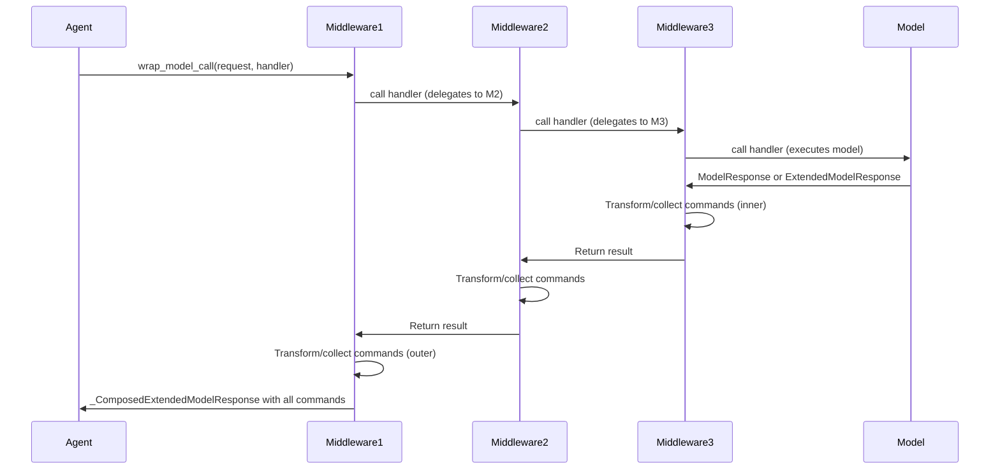

## Overview

Middleware in LangChain agents provides a composable, layered approach to intercepting and modifying agent behavior without changing core agent logic. Middleware hooks into the agent execution loop to implement cross-cutting concerns: automatic retries with exponential backoff, graceful error handling, human-in-the-loop approval workflows, tool argument validation, structured output transformation, request/response rate limiting, and tool call caching.

### Core Architectural Principles

**Interception Model**: Each middleware instance registers sync/async handler pairs for lifecycle hooks. When the agent executes, hooks are invoked in registration order, with each middleware observing or transforming state before delegating to the next layer or the core execution logic.

**Composition Semantics**: Middleware registered first in the list becomes the outermost layer. When composing `wrap_model_call` or `wrap_tool_call` handlers, each middleware wraps the previous ones, establishing a chain where the first middleware intercepts first and last.

- **Model call stack example**: `[Middleware1, Middleware2, Middleware3]` becomes `Middleware1(Middleware2(Middleware3(model)))`, so `Middleware1` receives control first, calls the next handler (which is Middleware2's wrapper), receives the result, and can transform it before returning.
- **Tool call stack**: Identical composition order — first middleware is outermost.

**State and Command Flow**: Most hooks return optional state updates (`dict[str, Any]`). The `wrap_model_call` and `wrap_tool_call` interception points also support returning `Command` objects from LangGraph, allowing middleware to redirect execution or jump to different nodes (e.g., skip tool execution, loop back to model, or exit).

## AgentMiddleware Protocol

All middleware classes inherit from `AgentMiddleware`, a generic base that defines optional hooks and establishes the contract for interceptors.

### Type Parameters

```python
class AgentMiddleware(Generic[StateT, ContextT, ResponseT]):
    """
    StateT: Type of agent state (default: AgentState[Any]).
    ContextT: Type of runtime context (default: None).
    ResponseT: Type of structured response (default: Any).
    """
```

### Lifecycle Hooks

Middleware can implement any or all of these lifecycle methods; unimplemented methods raise `NotImplementedError` if invoked in the wrong execution path (sync vs async):

#### Before/After Agent

```python
def before_agent(self, state: StateT, runtime: Runtime[ContextT]) -> dict[str, Any] | None:
    """Runs once at the very start of agent execution, before the first model call."""

async def abefore_agent(self, state: StateT, runtime: Runtime[ContextT]) -> dict[str, Any] | None:
    """Async version of before_agent."""

def after_agent(self, state: StateT, runtime: Runtime[ContextT]) -> dict[str, Any] | None:
    """Runs once after the agent loop terminates (no more tool calls or explicit exit)."""

async def aafter_agent(self, state: StateT, runtime: Runtime[ContextT]) -> dict[str, Any] | None:
    """Async version of after_agent."""
```

#### Before/After Model

```python
def before_model(self, state: StateT, runtime: Runtime[ContextT]) -> dict[str, Any] | None:
    """Runs before each model invocation; allows state transformation before the call."""

async def abefore_model(self, state: StateT, runtime: Runtime[ContextT]) -> dict[str, Any] | None:
    """Async version of before_model."""

def after_model(self, state: StateT, runtime: Runtime[ContextT]) -> dict[str, Any] | None:
    """Runs after each model response; allows approval, modification, or rejection of tool calls."""

async def aafter_model(self, state: StateT, runtime: Runtime[ContextT]) -> dict[str, Any] | None:
    """Async version of after_model."""
```

#### Wrap Model Call (Core Interception)

```python
def wrap_model_call(
    self,
    request: ModelRequest[ContextT],
    handler: Callable[[ModelRequest[ContextT]], ModelResponse[ResponseT]],
) -> ModelResponse[ResponseT] | AIMessage | ExtendedModelResponse[ResponseT]:
    """Intercept and control model execution.
    
    The handler callback executes the model call and returns ModelResponse.
    Middleware can:
    - Call handler once for normal execution.
    - Call handler multiple times for retry logic.
    - Skip calling handler to short-circuit (return a cached result).
    - Modify request before calling handler.
    - Transform response after handler returns.
    
    Returns ModelResponse, AIMessage (auto-wrapped), or ExtendedModelResponse (with Command).
    """

async def awrap_model_call(
    self,
    request: ModelRequest[ContextT],
    handler: Callable[[ModelRequest[ContextT]], Awaitable[ModelResponse[ResponseT]]],
) -> ModelResponse[ResponseT] | AIMessage | ExtendedModelResponse[ResponseT]:
    """Async version of wrap_model_call."""
```

#### Wrap Tool Call (Tool Interception)

```python
def wrap_tool_call(
    self,
    request: ToolCallRequest,
    handler: Callable[[ToolCallRequest], ToolMessage | Command[Any]],
) -> ToolMessage | Command[Any]:
    """Intercept tool execution.
    
    Called once per tool call with the full ToolCallRequest (tool name, args, call id, state, runtime).
    Middleware can:
    - Call handler for normal execution.
    - Call handler multiple times for retries.
    - Skip handler to return a cached result or mock.
    - Modify tool args before handler.
    - Convert exceptions to error ToolMessages.
    
    Returns ToolMessage or Command.
    """

async def awrap_tool_call(
    self,
    request: ToolCallRequest,
    handler: Callable[[ToolCallRequest], Awaitable[ToolMessage | Command[Any]]],
) -> ToolMessage | Command[Any]:
    """Async version of wrap_tool_call."""
```

### Configuration

```python
class AgentMiddleware(Generic[StateT, ContextT, ResponseT]):
    state_schema: type[StateT] = AgentState[Any]
    """Optional custom state schema. Merged with base AgentState during graph compilation."""
    
    tools: Sequence[BaseTool] = ()
    """Additional tools registered by this middleware (e.g., ShellToolMiddleware adds shell_tool)."""
    
    trace_policy: TracePolicy | None = None
    """Optional trace policy controlling what is captured in spans for this middleware's hooks."""
    
    transformers: Sequence[TransformerFactory] = ()
    """Stream transformer factories for streaming customization."""
```

## Core Middleware Types and Patterns

### Model Execution Middleware

**ModelRetryMiddleware**: Automatically retries failed model calls with exponential backoff when transient errors (rate limits, API timeouts) occur. Supports custom exception filtering, custom failure handlers, and jitter to avoid thundering herd.

```python
from langchain.agents.middleware import ModelRetryMiddleware

retry = ModelRetryMiddleware(
    max_retries=3,
    retry_on=(RateLimitError, APITimeoutError),
    backoff_factor=2.0,
    initial_delay=1.0,
    on_failure="continue",  # or "error" to re-raise, or callable
)
```

**ModelFallbackMiddleware**: Wraps the primary model with a fallback model (typically smaller/faster/cheaper) when the primary fails. Sanitizes provider-specific cache settings (Anthropic, Fireworks) to ensure compatibility across fallback attempts. Useful for reliability and cost optimization.

**ModelCallLimitMiddleware**: Enforces a maximum number of model calls per agent invocation or per thread, preventing runaway loops. Supports thread-level (persistent) and run-level (per invocation) counting with configurable exit behavior (`'continue'`, `'error'`, or `'end'`).

### Tool Execution Middleware

**ToolErrorMiddleware**: Converts tool execution exceptions (e.g., API errors, validation failures) into error `ToolMessage` objects sent back to the model, allowing the model to recover or clarify. Opt-in by exception type; exceptions not explicitly handled propagate unchanged.

```python
from langchain.agents.middleware import ToolErrorMiddleware

def on_error(exc: Exception, request: ToolCallRequest) -> str | None:
    if isinstance(exc, ValueError):
        return f"Invalid argument for {request.tool_call['name']}: {exc}"
    return None  # Propagate other exceptions

middleware = ToolErrorMiddleware(on_error=on_error)
```

**ToolRetryMiddleware**: Retries failed tool calls with configurable backoff and validation logic. Supports per-tool configuration and custom failure handlers. Commonly composed with ToolErrorMiddleware (ToolRetryMiddleware inner) to handle retryable errors gracefully.

**ToolCallLimitMiddleware**: Prevents infinite tool loops by enforcing a maximum number of tool calls per thread or per run. Supports selective limiting per tool and flexible exit behavior.

### Control Flow & Approval Middleware

**HumanInTheLoopMiddleware**: Pauses after model-requested tool calls and sends an interrupt with action summaries to a human reviewer. Uses the `after_model` hook to intercept AIMessage tool calls and send a HITLRequest for review. Supports approval, editing, rejection, or human-answered "respond" decision types. Tool calls are modified based on human feedback before execution.

```python
from langchain.agents.middleware import HumanInTheLoopMiddleware

hitl = HumanInTheLoopMiddleware(
    interrupt_on={
        "delete_file": True,  # All decision types allowed
        "search": {
            "allowed_decisions": ["approve", "reject"],
            "description": "Searching online databases",
        },
    }
)
```

The middleware constructs `ActionRequest` objects (with name, args, and optional description) and `ReviewConfig` objects (with action name and allowed decision types), sends them as a `HITLRequest` via `langgraph.interrupt()`, receives decisions back, and processes them:
- **approve**: Tool call proceeds unchanged
- **edit**: Tool call arguments are revised by the human
- **reject**: Tool call is blocked; a ToolMessage with user feedback is sent to the model instead
- **respond**: Tool execution is skipped; a synthetic ToolMessage with the human's answer is returned to the model

### Data Transformation & Privacy Middleware

**PIIMiddleware**: Detects personally identifiable information (PII) in prompts, model responses, and tool outputs; optionally redacts, masks, hashes, or blocks it. Supports configurable detectors and redaction rules with granular strategy control.

**ContextEditingMiddleware**: Allows dynamic modification of agent context (system message, available tools) during execution based on state or external events.

**FileSearchMiddleware**: Integrates file search capabilities into the agent, retrieving relevant documents before model calls using glob and grep patterns.

### System Tools Middleware

**ShellToolMiddleware**: Provides controlled shell command execution with configurable resource limits, sandboxing (host, Docker, Codex), timeout enforcement, and output truncation. Critical for security in untrusted environments.

**TodoListMiddleware**: Adds persistent todo list management capability to track and manage agent-generated tasks.

## Request and Response Types

### ModelRequest

```python
@dataclass
class ModelRequest(Generic[ContextT]):
    """Request context for model execution."""
    
    model: BaseChatModel          # The model to invoke
    messages: list[AnyMessage]    # Messages (excluding system message)
    system_message: SystemMessage | None  # System instructions
    tool_choice: Any              # Tool selection strategy
    tools: list[BaseTool | dict]  # Available tools
    response_format: ResponseFormat[Any] | None  # Structured output format
    state: AgentState[Any]        # Full agent state
    runtime: Runtime[ContextT]    # Runtime context
    model_settings: dict[str, Any]  # Additional model parameters
```

**Immutable Pattern**: Middleware should not mutate `ModelRequest` directly. Use `request.override(**changes)` to create a new request with modifications. Direct attribute assignment is deprecated and raises `DeprecationWarning`.

### ModelResponse

```python
@dataclass
class ModelResponse(Generic[ResponseT]):
    """Successful model execution result."""
    
    result: list[BaseMessage]                  # Messages (typically one AIMessage)
    structured_response: ResponseT | None = None  # Parsed structured output
```

### ExtendedModelResponse

```python
@dataclass
class ExtendedModelResponse(Generic[ResponseT]):
    """Model response with optional LangGraph Command for additional state updates."""
    
    model_response: ModelResponse[ResponseT]
    command: Command[Any] | None = None
```

Middleware can return `ExtendedModelResponse` to apply a command that modifies state after the model node completes. Commands are applied through state reducers, so messages in commands are **added** to existing messages (not replaced). Non-reducer state fields in commands follow outermost-wins semantics: when multiple middleware return commands, the outermost middleware's values for non-reducer fields override inner ones, but `messages` fields accumulate.

### ToolCallRequest

```python
@dataclass
class ToolCallRequest:
    """Request context for tool execution."""
    
    tool_call: dict  # Tool call dict with 'id', 'name', 'args'
    tool: BaseTool | None  # Resolved BaseTool instance (or None in batch mode)
    state: AgentState[Any]  # Agent state at time of call
    runtime: ToolRuntime  # Runtime context with tool-specific info
```

## Composition and Execution Order



This diagram shows hook execution order and how commands accumulate through the stack.

### Middleware Stack Execution

When middleware is registered as `[M1, M2, M3]`:

**Model Call Stack**:
1. M1's `wrap_model_call` is entered first
2. M1 calls handler → M2's `wrap_model_call` is entered
3. M2 calls handler → M3's `wrap_model_call` is entered
4. M3 calls handler → actual model execution
5. M3 returns result to M2
6. M2 can transform result and returns to M1
7. M1 can transform result and returns to agent

**Result**: Innermost middleware (M3, closest to model) executes first; outermost (M1) sees and can override all inner results.

### State Updates and Commands

State updates from hooks are merged using LangGraph reducers. For the `messages` field (which uses `add_messages` reducer), updates accumulate rather than replace.

**Command Accumulation**: When middleware returns `ExtendedModelResponse` with `Command`, multiple commands are accumulated in a list (inner-to-outer order). The agent applies them sequentially after the model node completes through the LangGraph state reducer system.

**Reducer Semantics**: 
- **Messages field**: Uses `add_messages` reducer, so messages in commands are **added** to the existing message list rather than replacing it.
- **Non-reducer fields**: Later commands overwrite earlier ones (outermost middleware wins). This means if multiple middleware return commands with state updates to the same field (other than `messages`), the outermost middleware's value takes precedence.

Example: If M1 and M3 both return commands with `{"status": "value"}`, M1's value (outermost) is used.

## Rate Limiting and Throttling Patterns

Middleware can implement rate limiting and throttling by tracking call counts and timing in the state. Key patterns include:

**Thread-level vs. Run-level Limits**: Middleware can maintain both persistent (thread-scoped) and per-invocation (run-scoped) counters. Thread-level limits persist across multiple agent invocations in the same thread, useful for per-session quotas. Run-level limits reset on each agent invocation.

**Exponential Backoff with Jitter**: Retry middleware implements exponential backoff (`delay = initial_delay * backoff_factor ^ attempt`) with optional random jitter to avoid thundering herd problems when multiple agents retry simultaneously.

**Adaptive Throttling**: Middleware can observe response times and model load indicators to adjust rate limits dynamically, reducing throughput during high-latency periods.

Example pattern using `before_model` hook to track and enforce rate limits:

```python
from langchain.agents.middleware import AgentMiddleware

class RateLimitMiddleware(AgentMiddleware):
    def __init__(self, calls_per_minute: int = 60):
        self.calls_per_minute = calls_per_minute
        self.call_times: list[float] = []
    
    def before_model(self, state, runtime):
        import time
        now = time.time()
        # Prune old calls outside the 1-minute window
        self.call_times = [t for t in self.call_times if now - t < 60]
        
        if len(self.call_times) >= self.calls_per_minute:
            # Wait until oldest call falls out of window
            sleep_time = 60 - (now - self.call_times[0])
            if sleep_time > 0:
                time.sleep(sleep_time)
        
        self.call_times.append(now)
        return None
```

## Error Handling Middleware: Fallbacks, Retries, and Recovery

**Fallback Chains**: ModelFallbackMiddleware wraps a primary model with ordered fallbacks. If the primary fails (raises exception, times out, or returns an error), the middleware retries with the next fallback model in the chain. This provides graceful degradation: prefer GPT-4o but fall back to GPT-4, then GPT-3.5-turbo if needed.

**Retry with Exponential Backoff**: ModelRetryMiddleware and ToolRetryMiddleware automatically retry on transient errors (rate limits, timeouts) with exponential backoff and optional jitter. Configuration allows custom exception filtering (which errors to retry) and on_failure behavior (continue with error message or re-raise).

**Error Message Injection**: ToolErrorMiddleware converts exceptions into error ToolMessages sent back to the model. The model sees a friendly error message and can decide to retry, call a different tool, or clarify its request. This is more graceful than halting execution.

**Recovery Strategies**: Middleware can implement recovery by:
- Returning alternative responses (cached results, default values) when the primary execution fails
- Modifying requests to be more lenient (removing optional tool arguments, simplifying queries)
- Injecting recovery hints into state (suggestions for the model to try different approaches)

## Logging and Monitoring Middleware for Observability

**Trace Policy**: Middleware can configure `trace_policy` to control what is captured in LangSmith traces:

```python
from langchain.agents.middleware import TracePolicy, omit_payload

class MyMiddleware(AgentMiddleware):
    trace_policy = TracePolicy(process_inputs=omit_payload)
    # Omit input payloads from traces to reduce noise, keep spans and timing
```

**Hook Naming**: Middleware hooks are automatically named in trace spans as `{middleware_name}.{hook_name}`, e.g., `ModelRetryMiddleware.wrap_model_call`, making it easy to identify which middleware handled each span in observability dashboards.

**Logging Best Practices**:
- Use `logger.debug()` for detailed execution flow (which middleware path was taken)
- Use `logger.warning()` for recoverable issues (retries, fallbacks)
- Use `logger.error()` for unrecoverable failures
- Avoid logging request/response content directly; log summary statistics instead (message count, tokens) to reduce PII exposure

Example logging middleware:

```python
import logging
from langchain.agents.middleware import AgentMiddleware

logger = logging.getLogger(__name__)

class ObservabilityMiddleware(AgentMiddleware):
    def before_model(self, state, runtime):
        msg_count = len(state.get("messages", []))
        logger.debug(f"Calling model with {msg_count} messages in context")
        return None
    
    def wrap_model_call(self, request, handler):
        import time
        start = time.time()
        try:
            response = handler(request)
            elapsed = time.time() - start
            logger.info(f"Model call completed in {elapsed:.2f}s")
            return response
        except Exception as exc:
            logger.error(f"Model call failed: {type(exc).__name__}", exc_info=True)
            raise
```

## Agent Factory Middleware: Applying Transformations

The agent factory (`create_agent()`) accepts a `middleware` list that is automatically integrated into the compiled graph. The factory:

1. **Collects middleware hooks** from all middleware instances
2. **Composes wrap_model_call handlers** via `_chain_model_call_handlers`, establishing first-is-outermost order
3. **Composes wrap_tool_call handlers** through ToolNode integration
4. **Merges state schemas** from middleware `state_schema` attributes into the base AgentState
5. **Registers additional tools** from middleware `tools` attributes
6. **Applies trace policies** to each middleware's hooks individually

**Key Invariant**: First middleware in the list becomes the outermost layer. Commands from each layer are accumulated in inner-to-outer order and applied sequentially after model execution through LangGraph's reducer-based state system.

## Writing Custom Middleware

### Simple Example: Logging Middleware

```python
from langchain.agents.middleware import AgentMiddleware, ModelRequest, ModelResponse

class LoggingMiddleware(AgentMiddleware):
    def before_model(self, state, runtime):
        num_messages = len(state.get("messages", []))
        print(f"[before_model] {num_messages} messages in state")
        return None  # No state updates

    def after_model(self, state, runtime):
        last_msg = state["messages"][-1] if state["messages"] else None
        if hasattr(last_msg, 'tool_calls'):
            print(f"[after_model] Model requested {len(last_msg.tool_calls)} tools")
        return None
```

### Retry Logic with Exponential Backoff

```python
import time
from langchain.agents.middleware import AgentMiddleware, ModelRequest, ModelResponse
from langchain_core.messages import AIMessage

class CustomRetryMiddleware(AgentMiddleware):
    def __init__(self, max_retries: int = 2, backoff_factor: float = 2.0):
        super().__init__()
        self.max_retries = max_retries
        self.backoff_factor = backoff_factor

    def wrap_model_call(self, request, handler):
        for attempt in range(self.max_retries + 1):
            try:
                return handler(request)
            except (TimeoutError, ConnectionError) as e:
                if attempt < self.max_retries:
                    delay = self.backoff_factor ** attempt
                    time.sleep(delay)
                else:
                    # Return error message instead of raising
                    return ModelResponse(
                        result=[AIMessage(content=f"Model call failed after {self.max_retries} retries: {e}")]
                    )
```

### Tool Argument Validation and Modification

```python
from langchain.agents.middleware import AgentMiddleware, ToolCallRequest
from langchain_core.messages import ToolMessage

class ArgumentValidationMiddleware(AgentMiddleware):
    def wrap_tool_call(self, request, handler):
        tool_call = request.tool_call
        args = tool_call["args"]
        
        # Example: ensure all string args are lowercase for a search tool
        if tool_call["name"] == "search":
            args = {k: v.lower() if isinstance(v, str) else v for k, v in args.items()}
            request = request.override(tool_call={**tool_call, "args": args})
        
        return handler(request)
```

### Conditional Tool Interception Based on State

```python
from langchain.agents.middleware import AgentMiddleware, ToolCallRequest

class ConditionalToolMiddleware(AgentMiddleware):
    def wrap_tool_call(self, request, handler):
        # Inspect agent state
        state = request.state
        user_message = next(
            (m.content for m in reversed(state["messages"]) if hasattr(m, "content")),
            None
        )
        
        # Only allow certain tools if user explicitly requests them
        if "search" not in user_message.lower() and request.tool_call["name"] == "search":
            return ToolMessage(
                content="Search tool requires explicit user approval.",
                tool_call_id=request.tool_call["id"],
                name=request.tool_call["name"],
                status="error",
            )
        
        return handler(request)
```

### Returning Commands from Middleware

```python
from langchain.agents.middleware import AgentMiddleware, ExtendedModelResponse
from langgraph.types import Command

class CommandReturningMiddleware(AgentMiddleware):
    def wrap_model_call(self, request, handler):
        response = handler(request)
        
        # Middleware can return ExtendedModelResponse with a Command
        # This command will be applied after the model node completes
        return ExtendedModelResponse(
            model_response=response,
            command=Command(update={"custom_field": "custom_value"})
        )
```

## Async and Sync Implementations

Middleware can provide sync-only, async-only, or both implementations. The agent will:

- Call sync versions (`wrap_model_call`, `wrap_tool_call`) in sync contexts (`stream()`, `invoke()`).
- Call async versions (`awrap_model_call`, `awrap_tool_call`) in async contexts (`astream()`, `ainvoke()`).
- Raise `NotImplementedError` if the required implementation is missing for the execution path, with guidance to implement both versions or use async execution.

**Best Practice**: Implement both versions unless the middleware is inherently async-only (e.g., uses async I/O).

## Integration with Agent Factory

Middleware is passed to `create_agent()` as a list:

```python
from langchain.agents import create_agent
from langchain.agents.middleware import ModelRetryMiddleware, ToolErrorMiddleware, HumanInTheLoopMiddleware

agent = create_agent(
    model=ChatOpenAI(),
    tools=[search, calculator],
    middleware=[
        ModelRetryMiddleware(max_retries=2),  # Outermost: retry model calls
        ToolErrorMiddleware(on_error=my_error_handler),  # Middle: handle tool errors
        HumanInTheLoopMiddleware(interrupt_on={"delete": True}),  # Innermost: approve risky tools
    ],
)
```

**Composition Rule**: First in the list = outermost (highest priority for interception and response transformation). The factory collects middleware with wrap_model_call and awrap_model_call hooks, composes them into a single middleware stack via internal composition functions, establishing an order where the first middleware becomes the outermost layer. Commands from each layer are accumulated in inner-to-outer order and applied sequentially after model execution through LangGraph's reducer-based state system.

## Common Patterns and Anti-Patterns

### ✅ Good Patterns

1. **Immutable Requests**: Use `request.override()` instead of mutating fields.
2. **Opt-in Error Handling**: Return `None` from error handlers to propagate exceptions (don't silently swallow).
3. **State-Driven Decisions**: Use `request.state` and `runtime` to make decisions; avoid global state.
4. **Clear Composition Order**: Document which middleware should run first, especially when order matters (e.g., retry before error handling).
5. **Fallback Behavior**: Implement sync and async versions to support both execution paths.
6. **Command Ordering**: When returning Commands, consider that multiple middleware commands stack—outermost middleware's non-reducer fields win.
7. **Logging with Context**: Log what middleware did, not secrets; include attempt counts and timing information.
8. **Rate Limiting Awareness**: When chaining retry and rate-limit middleware, place rate-limit outer to prevent retry storms.

### ❌ Anti-Patterns

1. **Mutating Request/Response Objects**: Direct assignment to `ModelRequest` fields is deprecated; always use `override()`.
2. **Silent Failures**: Don't catch and suppress exceptions in `on_error` handlers without returning content; let exceptions propagate if not handled.
3. **Hard-Coded Assumptions**: Don't assume specific tool names or message formats without validation.
4. **Blocking Async**: Never use `asyncio.run()` or sync I/O in async middleware implementations.
5. **Over-Composition**: Don't add more middleware than necessary; each layer adds latency.
6. **Ignoring Command Semantics**: Don't assume Command fields will accumulate like messages; remember that non-reducer fields follow outermost-wins semantics.
7. **Logging PII**: Never log request content, model responses, or tool arguments directly—extract summaries only.
8. **Retry Without Backoff**: Never retry immediately without delay; use exponential backoff to avoid overwhelming APIs.

## Key Invariants and Lifecycle

- **Immutability**: `ModelRequest` and `ToolCallRequest` follow an immutable pattern; use override/replace methods.
- **Execution Order**: Middleware runs in registration order (first = outermost). Multiple calls within a middleware (retries) do not reorder subsequent middleware.
- **State Reducer Semantics**: State updates via dict returns merge using reducer semantics. Messages accumulate via `add_messages`; non-reducer fields are overwritten by the most recent update.
- **Command Flow**: `ExtendedModelResponse` commands are collected (inner-to-outer) and applied after the model node completes through LangGraph reducers.
- **Sync/Async Consistency**: Choosing execution path (sync or async) is determined at agent invocation time; middleware cannot switch contexts mid-execution.
- **Exception Propagation**: Exceptions that are not explicitly handled propagate to the caller, unless a middleware converts them to a message or command.
- **Control-Flow Signals**: LangGraph interrupts and parent commands always propagate through middleware without being caught by error handlers.

## See Also

- [Agent Execution Flow and Loop Control](/openwiki/agent-execution.md) – Detailed description of the agent loop, state management, and where middleware hooks are invoked.
- [Agent Factory and Graph Construction](/openwiki/agent-factory.md) – How the agent graph is built, including middleware integration and handler composition.
- [Tools](/openwiki/tools.md) – Tool definition, registration, and execution context.
- [Runnables](/openwiki/runnables.md) – Composable execution model that underlies middleware composition.
- [Chat Models](/openwiki/chat-models.md) – BaseChatModel protocol that middleware intercepts.
